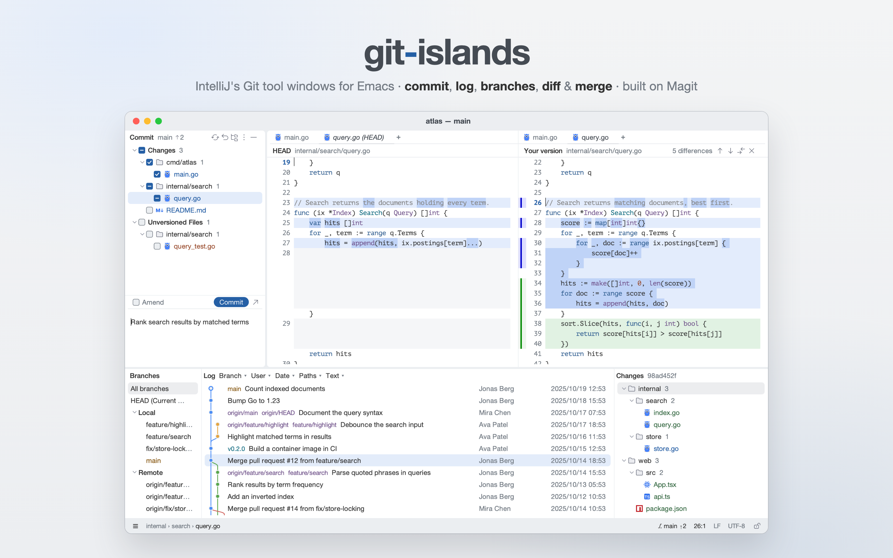
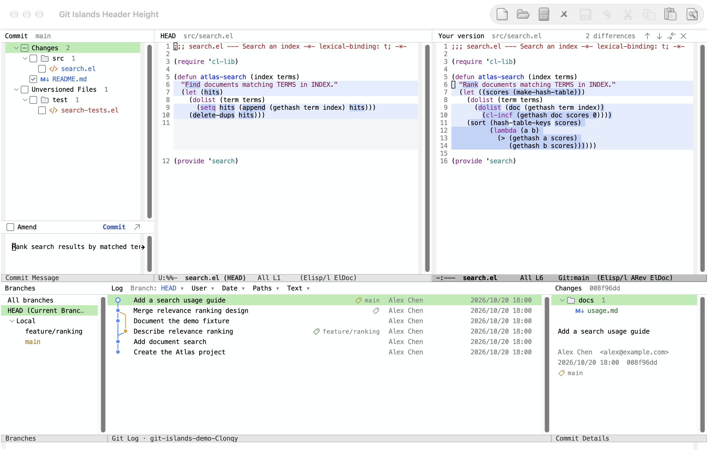

# git-islands

[English](README.md) | 简体中文



为 Emacs 提供 IntelliJ 风格的 Git 工具窗口：界面在 Emacs 中绘制，Git 操作由
[Magit](https://magit.vc) 驱动。

- **Commit 工具窗口**：改动文件按 changelist 和文件夹分组。文件的复选框就是
  index，勾选即暂存。下方是提交信息，带有 Amend、Commit 和 Commit and Push。
- **Git log**：带提交图的提交列表，可按分支、作者、日期、路径和文本过滤，
  旁边有分支窗格和详情窗格。用 Shift 和 Cmd-点击选中多个提交，可以
  cherry-pick、revert 或对比。
- **分支弹窗**：checkout、新建分支、update、push、merge 和 rebase。
- **Diff 与合并**：左右对照的 diff，每处改动都能单独暂存或撤销；冲突用三栏合并解决。
- **Annotate**：在边栏显示 blame，并与 log 联动。

只有在第一次打开工具窗口，或执行会改动仓库的命令时，才会加载 Magit。

## 不加载个人配置的效果

上方题图使用了个人 Emacs 配置。下图是在 `emacs -Q` 中仅加载 Git Islands
及其依赖的真实截图，保留默认字体、配色和工具栏。
[复现这个演示](docs/screenshots.md)。



## 依赖

- Emacs 29.1 或更高版本，需支持 SVG（用于绘制提交图、复选框和选中行）
- Magit 4.7 或更高版本
- [expui-icons](https://github.com/wwulfric/expui-icons) 0.2 或更高版本，需包含 `diff/gutterCheckBox@14x14` 尺寸变体

## 安装

用 `package-vc`（Emacs 29）安装：

```elisp
(package-vc-install "https://github.com/wwulfric/git-islands")
```

或者从本地 checkout 加载：

```elisp
(add-to-list 'load-path "/path/to/git-islands")
(require 'git-islands)
```

默认不绑定任何按键。可以单独绑定需要的命令，或把整个按键表挂在一个前缀下：

```elisp
(keymap-global-set "C-c g" git-islands-command-map)
;; 或者沿用 IntelliJ 的按键：
(keymap-global-set "s-0" #'git-islands-commit-toggle)
(keymap-global-set "s-9" #'git-islands-log-toggle)
(keymap-global-set "C-~" #'git-islands-branches-popup)
```

| 按键表中的键 | 命令 |
|---|---|
| `c` | `git-islands-commit-toggle`：Commit 工具窗口 |
| `k` | `git-islands-message-focus`：编写提交信息 |
| `l` | `git-islands-log-toggle`：Git log |
| `f` | `git-islands-log-file`：当前文件的历史 |
| `b` | `git-islands-branches-popup`：分支弹窗 |
| `a` | `git-islands-annotate`：annotate 当前文件 |
| `m` | `git-islands-conflicts`：解决合并冲突 |

## 融入你的配置

库提供可以直接使用的默认界面。Git 操作不依赖个人配置；编辑器集成通过下列变量完成，
样式通过库的 faces 设置，不改动全局主题、字体或 mode line。

### 从默认配置启动

安装依赖后，可以这样加载本地 checkout：

```elisp
(add-to-list 'load-path "/path/to/git-islands")
(require 'git-islands)
(keymap-global-set "C-c g" git-islands-command-map)
```

打开 Git 仓库中的文件，用 `C-c g c` 打开 Commit，或用 `C-c g l` 打开 Log。
`emacs -Q` 不会自动激活已安装的包：先执行 `(require 'package)` 和
`(package-initialize)`，或按[原生演示说明](docs/screenshots.md)显式指定依赖的加载路径。

### 宽度、行高与字体

将设置放在 `(require 'git-islands)` 之后。UI 和 diff 模块按需加载，
所以它们的设置应等相应模块定义 faces 后执行：

```elisp
(setq git-islands-side-window-width 44
      git-islands-message-window-height 8)
(with-eval-after-load 'git-islands-ui
  (setq git-islands-row-height 1.5
        git-islands-header-height 1.8)
  ;; 仅让工具窗格使用编辑器的默认字体。
  (custom-set-faces '(git-islands-ui-font ((t (:inherit default))))))
```

提交信息区初始总高度为 8 行（包括表头和 mode line），可手动调整；再次显示已打开的窗格不会重置高度。
将 `git-islands-message-window-height` 设为 `0.3` 可恢复此前的比例高度；设置对新窗口生效。

宽度以列为单位；行高以 frame 字符高度为单位，表头高度以字体单位计算。
默认 UI 字体继承 `variable-pitch`。标题用 `git-islands-title`，
列表文字用 `git-islands-file-name`。

### Log 窗格宽度

分支窗格默认占 frame 宽度的 15%（限制在 180–400 像素），详情窗格占 22%
（240–600 像素），为提交标题和作者留出更多空间。提交列表宽度达到 720 像素时
显示作者和日期，460–719 像素时只显示日期，更窄时两列都隐藏。窄 frame 下仍可能
隐藏作者；详情文字会随窗格宽度换行。

可拖动分隔线，或在打开 Log 前设置宽度。值的格式为 `(FRACTION MIN . MAX)`，
分别是 frame 宽度比例和像素上下限。已有自定义值的含义和优先级不变。
例如，以下设置可恢复之前的空间分配：

```elisp
(with-eval-after-load 'git-islands-log
  (setq git-islands-log-refs-width '(0.15 180 . 400)
        git-islands-log-details-width '(0.28 280 . 720)))
```

### Mode line

新工具缓冲区默认显示 `Git Log · project` 这样的简短标签，不显示内部 buffer 名和路径。
窄窗口省略仓库名，极窄窗口用省略号缩短标题；悬停标签可查看完整仓库目录。
这只影响 `default` 格式，自定义格式不变。
Commit 文件列表始终隐藏 mode line，与下方的提交信息区连成一体；提交信息区使用此设置。
Diff 源码缓冲区保留自身的 mode line。

```elisp
(setq git-islands-mode-line-format 'default) ; 库的简短默认格式。
;; 其他选择，按需选一个：
;; (setq git-islands-mode-line-format 'none) ; 隐藏。
;; (setq git-islands-mode-line-format nil)   ; 保留模式继承的格式。
;; (setq git-islands-mode-line-format '(" " mode-name)) ; 自定义格式。
```

已有的自定义格式（包括 `(:eval ...)`）原样使用，`nil` 保留以前的含义。
修改后，可在每个已打开的工具缓冲区中执行 `M-: (git-islands-set-mode-line)`，
也可以重新创建缓冲区。`nil` 不改变当前格式；要恢复模式继承的格式，需重新创建缓冲区。

### Diff 局部行号

左右两侧默认显示源文件的绝对行号；用于对齐的填充空行不会改变源文件行号或文件内容。
已有行号样式（包括相对行号和 visual 样式）保持不变；退出 Diff 时，工作文件缓冲区会恢复
由 Diff 临时修改的设置。设置作用于 buffer，因此另一个显示同一文件的窗口也会看到临时行号。
全局行号设置、字体和 faces 均不修改。

如果希望保持此前行为，只使用自己的行号设置，可在打开 Diff 前配置：

```elisp
(with-eval-after-load 'git-islands-diff
  (setq git-islands-diff-line-numbers nil))
```

行号外观使用 Emacs 标准的 `line-number` 和 `line-number-current-line` faces。

### 选中行与 diff 配色

先加载主题，再应用这些片段。`custom-set-faces` 设置用户 face spec，优先于主题中的 face。
如果会切换主题，请同时提供深浅背景两种定义。以下示例不依赖任何个人 face 或函数：

```elisp
(with-eval-after-load 'git-islands-ui
  (custom-set-faces
   '(git-islands-hl-line
     ((((background dark)) (:background "#30476A"))
      (t (:background "#DCE8FA"))))
   '(git-islands-hl-line-inactive
     ((((background dark)) (:background "#383B40"))
      (t (:background "#ECEEF2"))))))

(with-eval-after-load 'git-islands-diff
  (custom-set-faces
   '(git-islands-diff-added
     ((((background dark)) (:background "#243D2B" :extend t))
      (t (:background "#E3F3E6" :extend t))))
   '(git-islands-diff-deleted
     ((((background dark)) (:background "#492D32" :extend t))
      (t (:background "#F8E4E7" :extend t))))))
```

文件状态颜色 `git-islands-modified`、`git-islands-added`、`git-islands-deleted`、
`git-islands-untracked`、`git-islands-conflict` 定义在 `git-islands-faces.el`。
Diff 配色单独定义在 `git-islands-diff.el`，还包括 `git-islands-diff-modified`、
`git-islands-diff-word` 和 `git-islands-diff-filler`。

[examples/style.el](examples/style.el) 将以上设置组合为可选的独立示例。
在主题之后执行 `(load "/path/to/git-islands/examples/style.el")` 即可加载。
它演示库本身的样式设置；题图还使用了编辑器全局的个人样式。

建议先设置样式，再打开窗格。已有文字 face 可能立即更新，但 SVG 图像、表头 face remapping
和行布局可能需要重建。保存提交信息后，kill 掉受影响的工具缓冲区再重新打开，确保所有设置生效；
仅隐藏再显示窗格会复用原缓冲区。当前版本不保证所有已打开窗格都能实时更新样式。

### 编辑器集成回调

| 变量 | 调用约定与默认行为 |
|---|---|
| `git-islands-header-function` | 接收一个表头 mode line format，返回 mode line format；默认为 `identity`。重绘时在工具缓冲区中调用，选中的窗口未必是该缓冲区的窗口。应保持轻量且无副作用。 |
| `git-islands-background-function` | 无参数，返回 Emacs 颜色字符串或 `nil`；绘制或初始化时在工具缓冲区中调用。默认 `nil` 使用 default face 的背景。修改后重新创建缓冲区以更新表头 remapping。 |
| `git-islands-with-anchor-function` | 接收两个无参数函数 `ANCHOR` 和 `READ`。`ANCHOR` 返回 frame 内像素坐标 `(X Y 0)`（无 Log 窗口时为 `nil`），定位时再求值。在发起过滤操作的上下文中同步调用 `READ`，返回其结果，保留退出和错误行为。默认只调用 `READ`。 |
| `git-islands-fallback-directory-function` | 无参数，在未找到仓库时于发起命令的缓冲区中调用，返回目录字符串或 `nil`。默认 `nil` 不提供后备目录。 |
| `git-islands-side-window-width` | 正整数列数，或返回列数的无参数函数；默认 40。打开和调整窗格时调用，不应假定当前是工具缓冲区。请在打开窗格前设置。 |
| `git-islands-side-window-hook` | 无参数 hook，在创建 Commit 缓冲区之后、显示窗口之前运行；当前仍是发起操作的缓冲区，忽略返回值。默认空，可用于隐藏另一侧栏以腾出空间。 |
| `git-islands-line-end-inset` | 表头右侧保留的像素数，或绘制时返回像素数的无参数函数；默认 0，可配合编辑器的圆角边缘。 |

这些回调均为可选。例如，以下完整实现保留普通表头和 minibuffer 行为：

```elisp
(setq git-islands-header-function (lambda (format) format)
      git-islands-background-function (lambda () nil)
      git-islands-with-anchor-function
      (lambda (_anchor read) (funcall read)))
```

包装表头时应保留传入的格式及按钮属性；适配弹窗时应保留发起操作的 buffer/window 上下文。
回调在后续调用时读取，并不自动重建已有绘制内容。具体约定也可查看各变量的 docstring。

`git-islands-status-functions` 是独立的功能集成 hook，仓库状态变化时以仓库根目录为参数调用。
`git-islands-status` 返回最新状态快照，供文件树或状态栏使用。调整样式不需要这个 hook。

## 开发

```sh
make compile   # 字节编译，警告视为错误
make test      # 运行 ERT 测试
```

Makefile 在 `DEPS` 下查找依赖，每个依赖一个目录。默认在本 checkout 的同级目录中查找，
即作为子模块与 Magit、expui-icons 放在一起的情况。也可以指定其他位置，例如
`make test DEPS=~/.emacs.d/elpa`。

## 许可证

Apache License 2.0，见 [LICENSE](LICENSE)。
